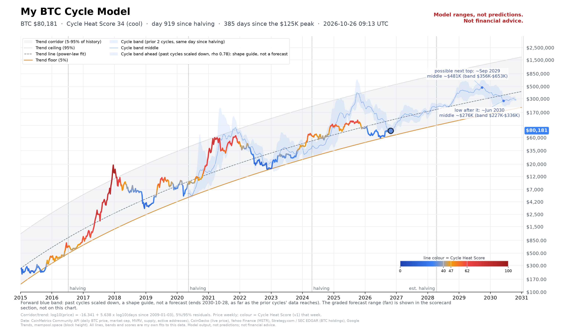

# My BTC Cycle Model

Live site: https://euthymia686.github.io/my-btc-cycle-model/

A live Bitcoin cycle chart built from raw public data:
- **Projection fan** (5/25/50/75/95%): a power-law trend refit daily, widened by how wrong that trend has actually been out of sample. A copy frozen on 2026-10-25 is kept unchanged and scored only on later data.
- **Cycle Heat Score** (0-100): valuation, on-chain, usage, attention and halving-timing signals, each turned into a percentile against its own history.
- **Cycle band**: where the two previous halving cycles sat at the same day since halving.

> **Disclaimer.** These are model ranges, not predictions. Nothing here is financial advice or a recommendation to buy or sell anything.
> Past cycles may not repeat, data sources can be wrong or late, and the code may contain errors. Do your own research.

## How it works
- `index.html`, `js/`, `css/`: static site. Live prices stream from Coinbase, Kraken and Bitstamp public WebSockets, and blocks from mempool.space, straight into the browser.
- `data/*.json`: daily files rebuilt by `build_data.py` from `pipeline/`.
- `pipeline/`: data fetch and models (CoinMetrics Community, CoinGecko, Yahoo Finance, Google Trends, Strategy.com / SEC EDGAR). If a source fails, the last cached copy in `pipeline/cache/` is used.
- `pipeline/frozen/`, `pipeline/v2_spec.py`, `pipeline/robust.py`: pre-registered, hash-checked. They are never edited; any change becomes a new version.
- `pipeline/frozen/`: locked model versions. v2 (`v2_freeze.json`, the frozen fan) and v3 (`v3/`: pre-registered rules, tests, and `FREEZE.md` with what v3 changes and the rule for promoting it over v2), both frozen 2026-10-25. `FROZEN_SHA256SUMS` lists every frozen file; the workflow fails if any of them changes. The list is timestamped in the Bitcoin blockchain with OpenTimestamps (`pipeline/timestamps/`). Two v3 research files are not published; their hashes are in `v3/withheld_sha256.txt`.
- `pipeline/scorecard.py` and `data/scorecard.csv`: the public forward scorecard. Each daily run logs the v2 and v3 forecasts for 30, 90 and 365 days ahead and grades them when they mature (inside the 50% band, inside the 90% band, log score). Rows are only appended, once per daily close.
- `.github/workflows/update-and-deploy.yml`: runs daily at about 00:30 UTC (or manually). It rebuilds the data, commits it if anything changed, and deploys to GitHub Pages.

Run it locally: `pip install -r requirements.txt && bash scripts/update.sh && python -m http.server`.

See `docs/ARCHITECTURE.md`, `docs/ROBUSTNESS.md` and `pipeline/SOURCES.md`.

## How this was built

Designed and directed by Euthymia686, built with help from an AI assistant. The model rules, data sources and code are all public in this repo, locked versions are hash-checked, and every forecast is graded on the public scorecard, so you can judge the work by its track record rather than by who or what wrote it.

## License

Copyright (c) 2026 Euthymia686. This project is licensed under the [PolyForm Noncommercial License 1.0.0](https://polyformproject.org/licenses/noncommercial/1.0.0) (see `LICENSE`).

- Free for personal and other non-commercial use, including study, research and hobby projects.
- Commercial use needs permission from the copyright holder. Open an issue on this repository to ask.
- Earlier copies of this repository were published under the MIT License. Copies obtained under MIT keep those terms; this license applies from this commit on.

The bundled Lightweight Charts library is (c) TradingView and stays under its own Apache-2.0 license.
